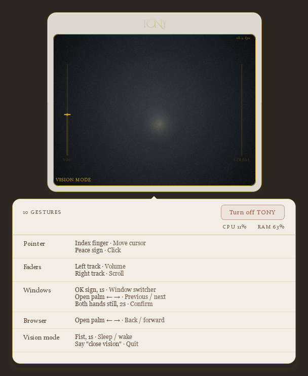
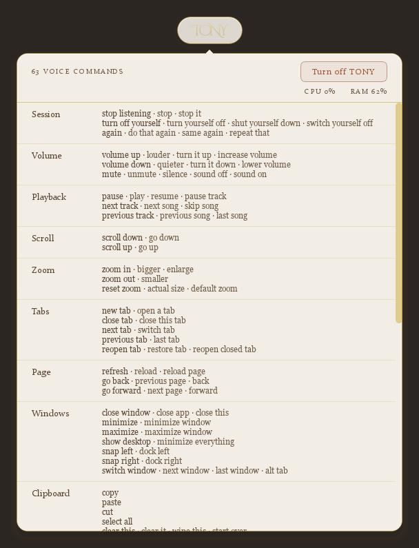
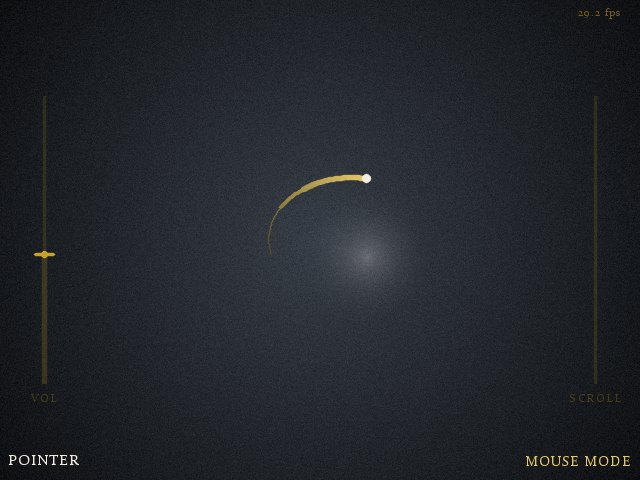
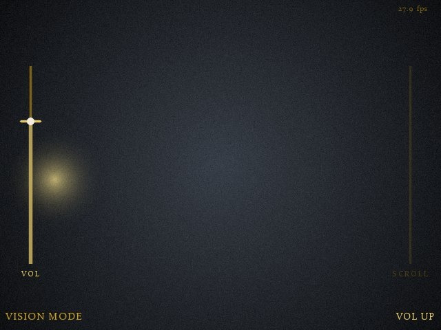

# TONY App

Say **"Tony"**, then a command — and your computer does it.

A voice assistant for Windows that runs entirely on your own machine. No cloud, no
account, no API key, nothing sent anywhere. It also reads hand gestures through your
webcam.

<p align="center">
  
</p>

---

## What it is

TONY sits at the top of your screen as a small glass pill. Say its name and it listens
for 20 seconds — long enough for a few commands in a row. Say "volume down 40", "close
tab", "open gmail", "screenshot", and it happens.

It is **not** a chatbot. It does not talk back, does not answer questions, and there is
no AI model deciding what you meant. It matches what you said against a fixed list of
63 commands and runs the matching one. That is why it is fast and never does something
strange.

| Waiting | Listening |
|---|---|
|  |  |

It glows while listening and sits still when it isn't. After each command a small note
appears under it:

<p align="center">
  
</p>

Click the pill to see everything it can do:

<p align="center">
  
</p>

---

## What you can say

63 commands, including:

- **Volume and music** — volume up/down (or "volume down 40" for exactly that), mute,
  play, pause, next track
- **Scrolling and zoom** — scroll up/down, zoom in/out
- **Tabs and pages** — new tab, close tab, next tab, refresh, go back
- **Windows** — close, minimize, maximize, show desktop, snap left/right, switch window
- **Editing** — copy, paste, cut, select all, undo, redo, save
- **Selection** — "search this", "translate this", "research this" on whatever you have
  selected
- **Typing** — "type mode": everything you say gets typed for you
- **Capture** — screenshot, record the screen, open the gallery
- **Opening things** — Chrome, Notepad, Settings, Gmail, YouTube, Spotify, Claude…

Click the pill for the full list with every phrase that works.

---

## Vision mode

Say **"open vision"** and the pill grows into a panel showing your camera. Now your
hands control the computer.

| Gesture | What it does |
|---|---|
| ☝️ Index finger | Move the mouse |
| ✌️ Peace sign | Click |
| 👌 OK sign, hold 1 second | Switch windows |
| ✋ Open palm, swipe left/right | Back / forward |
| 👊 Fist, hold 1 second | Pause / resume |
| ✋ Left edge, move up/down | Volume |
| ✋ Right edge, move up/down | Scroll |

<p align="center">
  
  
</p>

Say **"close vision"** and it goes back to being a pill. The camera is only on while
vision mode is.

---

## Setup

You need **Windows 10 or 11**, a **microphone**, and **Python 3.10+**
([download it here](https://www.python.org/downloads/) — tick *"Add python.exe to
PATH"* during the install). A webcam only if you want vision mode.

**1. Download the code**

```powershell
git clone https://github.com/aesatyilmaz/TONY-App.git
cd TONY-App
```

**2. Install what it needs**

```powershell
pip install -r requirements.txt
```

**3. Start it**

```powershell
python app.py
```

The first time you run it, TONY downloads two speech models (about 540 MB). That
happens once — after that it works with no internet at all.

To stop it: click the pill → **Turn off TONY**.

---

## Put it on your desktop

So you can start TONY by double-clicking an icon, like any other program:

```powershell
python tools/shortcuts.py --desktop
```

That puts a **TONY** icon on your desktop. Double-click it and TONY starts quietly —
no black console window.

Want it to start by itself every time you turn the computer on?

```powershell
python tools/shortcuts.py --startup
```

To undo either of them:

```powershell
python tools/shortcuts.py --remove
```

> If you move the project folder afterwards, run the command again — the shortcut
> remembers where the folder was.

---

## Settings

You don't have to change anything. If you want to, create
`config/settings.json` and put in only what you want to differ:

```json
{
  "active_window_seconds": 20,
  "volume_step": 5,
  "activate_hotkey": "ctrl+alt+t"
}
```

The rest, with explanations, is in `config/settings.py`.

---

## Privacy

- **Your voice never leaves your computer.** Everything is processed locally. No
  server, no account, no telemetry, and nothing is recorded to disk.
- **The camera only runs while vision mode does**, and no image is ever saved.
- **The one exception:** the first launch downloads the speech models. After that TONY
  works completely offline.
- Screenshots and recordings stay in the `gallery/` folder on your machine.

---

## License

[MIT](LICENSE) © Esat Yilmaz — free to use, change and share.

For the design documents behind it, see [`docs/`](docs).
